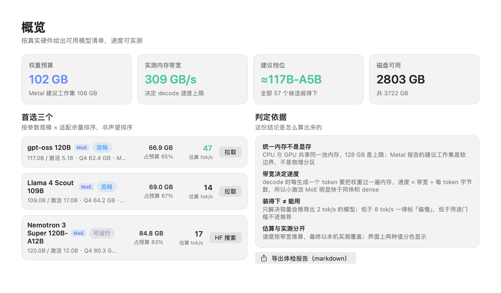
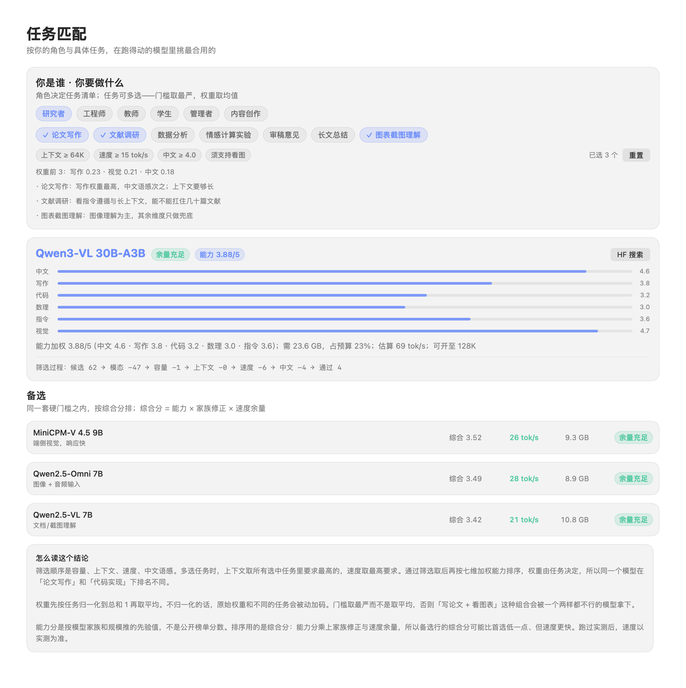

# MindModel

这台机器能跑哪个模型、跑多快、为什么是它。

> **🌐 官网**：https://sxhfut.github.io/MindModel/ ｜ **📦 下载**：见 [Releases](https://github.com/sxhfut/MindModel/actions)（三平台安装包）｜ **🖥 无需安装**：`cargo run -p mindmodel-server` 后用浏览器打开

本地模型的选型有个常见麻烦：网上按「显存够不够」列的清单，把权重体积当成唯一门槛，忽略了 KV cache、上下文长度和内存带宽。照单下了一个 70 GB 的模型，上了 30K 上下文才发现余量吃掉一半，生成速度 4 tok/s。

MindModel 把选型拆成能算的几步：预算、需求、上下文、速度、能力分。给定机器和任务，给出一个结论，以及结论背后的每一个数字。所有计算在本机完成，不联网。

```
$ mindmodel scan
芯片      : Apple M5 Max
统一内存  : 128.0 GB（unified=true）
工作集    : 107.5 GB
预算      : 102.4 GB
带宽实测  : 344 GB/s（峰值；中位 336 · 最低 330）

可承载 78/79 个内置候选；建议档位 ≈117B-A5B
```

## 界面



总览页给出预算来源、带宽实测值、当前可承载的模型档位，以及各分类的容量分布。


任务页支持多选。选中的任务会合并成一个筛选条件，页面上写明每道门槛的数值、被砍掉多少候选、首选模型的能力分拆解。合成规则见下文。



筛选过程逐步显示：候选池 79 → 去掉非对话模型 → 容量 → 上下文 → 速度 → 中文 → 通过 19。哪一道门槛砍得最狠，一眼能看出来。

## 判定怎么算

```
预算   = min(平台建议工作集, 0.80 × 物理内存)
需求   = 权重 + KV + 运行时(1.6 GB)
KV     = 2 × 层数 × KV头数 × head_dim × 2B × 上下文
速度   = 实测带宽 × 0.45 ÷ (权重 × 激活占比 + 0.25)
档位   = 需求/预算 ≤ 40% 余量足 / 72% 流畅 / 92% 可运行 / 115% 偏紧 / 超出
```

速度这一行是整个工具的核心。每生成一个 token，都要把参与计算的权重从内存里完整读一遍，所以速度大致等于带宽除以每 token 的字节数。MoE 只读被激活的专家，`0.45` 是实测拟合出的效率系数，不是理论峰值。

三条实现上的约束，都是踩过坑之后定下的：

1. **MoE 的激活占比不钳下限。** 钳到 0.25 会把 30B-A3B 当成 6B，系统性高估大体积 dense 模型。
2. **GGUF 数组按真实元素个数跳过。** 分词表动辄 12.8 万条，截断一次后面全部错位，得出的参数量是假的。
3. **估算值可以被实测覆盖。** 跑过一次 generate 之后，界面用实测值，并用颜色区分两者来源。

## 多选任务的合并规则

真实场景很少是单一任务。同时要"写论文 + 看图表"时，两套门槛怎么合成写死在代码里（Rust `task.rs` 与 Swift `TaskBlend` 逐条对齐）：

| 维度 | 合并方式 | 理由 |
|---|---|---|
| 七维权重 | 每个任务先归一化到 sum=1 再取均值 | 原始权重之和不同的任务混在一起，等于偷偷给某些维度加码 |
| 上下文门槛 | 取最大 | 组合里有一个要 64K，就必须撑得住 64K |
| 速度门槛 | 取最高 | 有一个要 28 tok/s，就按 28 筛 |
| 中文门槛 | 任一任务以中文为主即生效 | 放宽会让中文语感 3.0 的模型拿下中文写作 |
| 模态门槛 | 任一任务需看图，则排除纯文本模型 | 图表理解是硬需求，不是权重高一点 |
| 家族修正 | 按各任务取均值 | 否则只要选了编码，写作分就被整体腰斩 |

门槛一律取最严。取平均时，"写论文 + 看图表"会被一个两样都不行的中庸模型夺冠。

候选池只按模态收窄，不按类别收窄。多模态模型同样是称职的文本模型，Qwen3-VL 30B-A3B 的中文和写作都不弱；按类别把文本任务的候选池砍到 34 个是错的，会白白丢掉好候选。只有明确要求看图的任务才筛 `vision > 1.5`。

筛选账目必须闭合。某道门槛把候选砍光时会自动退回上一级，否则用户永远拿不到结果；此时账目标 `(已放宽)` 并单独给一行警告，不会出现"速度 -34… 通过 19"这种自相矛盾的数字。

## 页面

| 页面 | 内容 |
|---|---|
| 总览 | 机器信息、预算、带宽、建议档位、容量分布、模型体检 |
| 任务 | 12 类任务多选，门槛明细，首选与备选，筛选过程账目 |
| 在线模型 | 在应用内搜索 HuggingFace + 魔搭的 GGUF 模型，清单外也能找，按下载量排序、展示 license，一键下载 |
| 导入 | 拖入 GGUF 或整个目录，自动识别分片与投影器，改模型名，批量注册进 Ollama |
| 模型 | 已装模型列表，量化/参数量/上下文/能力标签，搜索排序，多选删除，磁盘体检与孤儿 blob 回收 |
| 硬件 | 完整探测结果，重新实测带宽，导出报告 |
| 实测 | 对已装模型跑一次生成，记录 tok/s，覆盖估算值 |
| 对话 | 直接调用本机 Ollama 模型，支持图片输入，流式输出，记录实测速度 |
| 智能体 | 让模型动手：读文件、列目录、搜索、写文件、跑命令，工具调用循环，写与命令需确认 |

模型清单内置 79 条，覆盖十类：通用对话、代码、推理、多模态理解、Agent、轻量、图像生成、语音、向量、重排。只有可对话的类别参与对话选型——把图像生成模型混进推荐列表，会让它拿下"首选"并打印一个编造出来的 tok/s。

## 模型从哪里来

MindModel 专注**本地模型**，模型来源分三层，相互补充：

| 来源 | 说明 | 是否自动 |
|---|---|---|
| 内置精选目录（79 条） | 精心挑选 + 手工标注适配数据（体积/KV/速度），是推荐引擎的权威源 | 手工维护（改清单后跑 `gen_models_toml.py`） |
| 在线搜索（HF + 魔搭） | 应用内直接搜 HuggingFace 和魔搭的 GGUF 模型，清单外也能找，按下载量排序 | 实时（每次搜索都拉最新） |
| GGUF 导入 | **任意 .gguf 均可导入，无模型白名单**——从任何渠道下的本地文件都能注册进来用 | 手动导入 |

内置目录的价值在"适配判定"（这台机器能不能跑、跑多快），这些数据需要手工标注，无法自动生成；所以它不自动刷新。清单之外的模型由"在线搜索 + 无白名单导入"覆盖——你在 HuggingFace、魔搭、网盘、任何地方找到的 GGUF，都能导进来用，不受内置 79 条限制。

## 架构

一套算法，三种壳。内核是 Rust 纯逻辑，外层 Tauri 桌面 / 浏览器兜底 / CLI 三种入口共用同一份前端：

```
        ┌─ Tauri 桌面 ──┐
        │ macOS/Win/Linux│
        ├─ 浏览器兜底 ──┤      ┌──────────────────────────────┐
        │ 麒麟/龙芯/服务器│─────▶│  共享前端 ui/                 │
        └─ 命令行 CLI ──┘      │  (Vite + 原生 JS)            │
                               └──────────────┬───────────────┘
                                              │
              ┌───────────────────────────────▼───────────────┐
              │  Rust 内核（零外部依赖）                       │
              │  core   · gguf / advisor / catalog / task     │
              │  probe  · 硬件探测（按 target 编译）           │
              │  backend· Ollama / llama.cpp / MLX 抽象       │
              │  server · 本地 HTTP（/api/scan·engines·advise）│
              └───────────────┬───────────────────────────────┘
                              │
              ┌───────────────▼───────────────┐
              │  data/models.toml · 79 条清单  │
              └───────────────────────────────┘
```

算法全在本地跑，不联网。Swift 版（macOS 桌面）与 Rust 版是同一套公式的独立实现，用断言维持两端选型逐字一致。

## 命令行

Rust 版是同一套算法的独立实现，用于交叉校验和 CI：

```
mindmodel scan                              硬件体检 + 带宽实测 + 预算
mindmodel advise [--ctx 16384] [--purpose writing|coding|reasoning|vision|longdoc|alwayson]
mindmodel task [--tasks paper,lit,code,...] [--ctx 16384] [--bandwidth 344] [--budget 102.4]
mindmodel parse <文件...>                   解析 GGUF 头部（含分片/投影器识别）
mindmodel list                              列出内置模型清单
mindmodel engines                           检测本机推理后端
```

`--bandwidth` 与 `--budget` 用于离线复算：拿到别人的报告时，可以指定同样的输入验证结果。

无 GUI 平台还有浏览器兜底：`cargo run -p mindmodel-server` 起本地 HTTP 服务，浏览器打开 `http://127.0.0.1:8462` 即用（见 `shells/browser/README.md`）。

## 编译

macOS 桌面版（SwiftUI，无第三方依赖）：

```bash
./build.sh          # 产出 build/MindModel.app
```

Rust 核心与命令行：

```bash
cd rust
cargo test          # 26 个测试（24 core + 2 backend），其中 5 条钉住与 Swift 首次选型逐字一致
cargo build --release
```

两边的一致性靠断言维持，不靠人工比对：同一台机器、同一组任务，Swift 与 Rust 的首选、候选数、每道门槛的砍掉数量、能力分、估算速度都必须相同。改算法时改一边，另一边的测试会红。

## 现在是什么状态

macOS 已在 Apple M5 Max / 128 GB / macOS 27.0.1 上实跑验证，包含带宽实测、GGUF 导入、Ollama 注册、真实生成测速、以及智能体的工具调用（qwen2.5:14b 的 function calling 端到端跑通）。

跨平台桌面壳（`shells/tauri` + `ui/`）已可编译：本机 `cargo tauri build` 产出 11MB 的 macOS 应用；Windows 与 Linux 的 `.exe` / `.deb` / `.AppImage` 由 CI 在对应 runner 上编译（`.github/workflows/release.yml`），产物上传为 artifact。**但 Windows/Linux 尚未在真实硬件上打开运行过**，探测层（DXGI/NVML、sysfs/NVML）与打包结果需要真机点开验证。

无 GUI 平台的浏览器兜底壳（`shells/browser` + `rust/crates/server`）已在本机端到端跑通：`mindmodel-serve` 起本地 HTTP 服务，暴露 scan/engines/models/advise/task 五个 JSON 端点 + 静态文件，浏览器打开即用。这是国产平台（鲲鹏/飞腾/龙芯/海光）最可行的入口。

Rust core 的跨平台探测按 `cfg(target_os)` 分文件，国产平台（鲲鹏、飞腾、龙芯、海光）只做到代码能编译，没有任何实测数据。界面上区分「未验证 / 可运行 / 已实测」三档。

内置候选两边一致：Swift 版与 Rust core 均为 79 条。`data/models.toml`（79 条）已作为单一数据源生成，Swift 的 `Catalog.swift` 是权威源，改清单后跑 `python3 tools/gen_models_toml.py` 重新生成。

## 目录

```
MindModel/
├── Sources/
│   ├── Probe.swift      硬件探测：sysctl + Metal 工作集 + 带宽实测
│   ├── Catalog.swift    模型清单、能力画像、已装模型盘点与磁盘体检
│   ├── GGUF.swift       GGUF 头部解析：量化、参数量、KV、分片、mmproj
│   ├── Advisor.swift    预算/需求/速度/能力分/任务合成
│   ├── Agent.swift      智能体工具层：读文件/列目录/搜索/写文件/跑命令
│   ├── HFSearch.swift   在线模型搜索：HuggingFace + 魔搭 GGUF（零依赖 URLSession）
│   ├── App.swift        状态、并发、Ollama 交互、agent 循环
│   └── Views.swift      八个页面
├── rust/
│   └── crates/{core,probe,backend,cli,server}
├── shells/
│   ├── tauri/           跨平台桌面壳（macOS 可编译，Win/Linux 靠 CI）
│   ├── ui/              共享前端（Vite + 原生 JS，两壳共用）
│   └── browser/         无 GUI 平台的浏览器兜底（mindmodel-serve 本地 HTTP）
├── data/models.toml     模型清单单一数据源（79 条）
├── tools/gen_models_toml.py  从 Catalog.swift 生成 models.toml
├── docs/                界面截图 + GitHub Pages 主页
├── DESIGN.md            跨平台设计与算法说明
└── build.sh
```

## 已知限制

- **能力分是编辑先验，不是基准测试。** 七维分数按模型家族与参数量推导，用来在"这台机器都跑得动"的候选之间排序，不能拿去跨硬件比较，也不能当成 MMLU 之类的分数。
- **带宽实测受机器负载影响。** 每轮单独计时取峰值，跑之前会先做两轮预热；机器不空闲时最低值会明显偏低，所以界面上同时给出峰值、中位、最低三个数。
- **删除模型只对 Ollama 托管的生效。** 手工放进目录的 GGUF 只提供"在 Finder 中显示"，不做删除——路径归属无法可靠判断。
- **不下载模型。** 导入是本地文件注册进 Ollama，下载交给 Ollama 自己做。
- **智能体工具调用依赖模型的 function calling。** 不是所有本地模型都支持；写文件与执行命令默认要用户逐次确认，纯读操作不需要授权。

## 许可

代码用 Apache-2.0，含专利授权条款，企业和高校采用时法务阻力最小。

不内置任何模型权重，只提供清单与元数据。各模型自带许可，不随本项目授权。

Copyright 2026 多模态情感计算与人因工程团队
